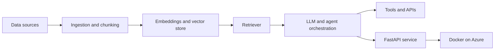
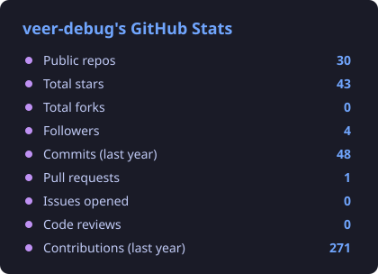
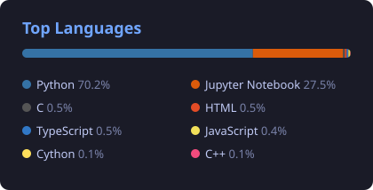

<div align="center">

[](https://github.com/veer-debug)

**Member of Technical Staff @ Octro Inc.**

[](https://www.linkedin.com/in/ranveer-kumar-12050a247)
[](https://ranveer-kumar.vercel.app/)
[](mailto:ranveep097@gmail.com)
[](https://drive.google.com/file/d/1iwX-8obVGHdDQtIgj67Mc3u4Qhu0jGfw/view?usp=drivesdk)

</div>

## About

I'm an AI/ML engineer based in India who turns LLM research into reliable, scalable products. I build AI analytics systems and agent-driven workflows for product analytics and automation, and I also work across applied ML, computer vision and data engineering.

```python
class RanveerKumar:
    role = "AI/ML Engineer"
    focus = ["LLM agents", "RAG pipelines", "AI analytics"]
    exploring = ["multi-agent orchestration", "LangGraph", "CrewAI"]
    stack = ["Python", "FastAPI", "LangChain", "PyTorch", "Docker", "Azure"]
    philosophy = "First, solve the problem. Then, write the code."
```

## How I build LLM systems



## Tech Stack

| | |
| --- | --- |
| **Languages** |     |
| **LLMs & Agents** |      |
| **ML & Vision** |       |
| **Backend & Cloud** |      |

## Selected Projects

| Project | What it does | Stack |
| --- | --- | --- |
| **[HireAntra](https://hireantra.com)** | AI hiring platform: resume screening, AI interviews, candidate evaluation and proctoring | Python, LLMs, FastAPI, Docker, Azure |
| **AI Voice Support Agent** | AI calling agent for appointment scheduling and customer support | MCP, Twilio, LangChain, FastAPI, RAG |
| **Match My Mansion** | Real-estate analytics and price-prediction web app with personalised recommendations | Python, Flask, ML, MySQL |

## Experience

| Role | Company | Period |
| --- | --- | --- |
| **Member of Technical Staff** | Octro Inc., Noida | Jul 2025 – Present |
| AI/ML Intern | TOD-SMA (Remote) | Apr 2025 – Jul 2025 |
| AI/ML Intern | Damsonic | Jan 2025 – Jun 2025 |

## Education & Achievements

- B.Tech, Computer Science — Shaheed Bhagat Singh State University
- Competitive programming: LeetCode Knight (max 2085) · Codeforces Pupil (max 1374)
- NCC Inter-Group Sport Shooting — 3rd place (2023)

## GitHub Stats

<div align="center">




</div>


